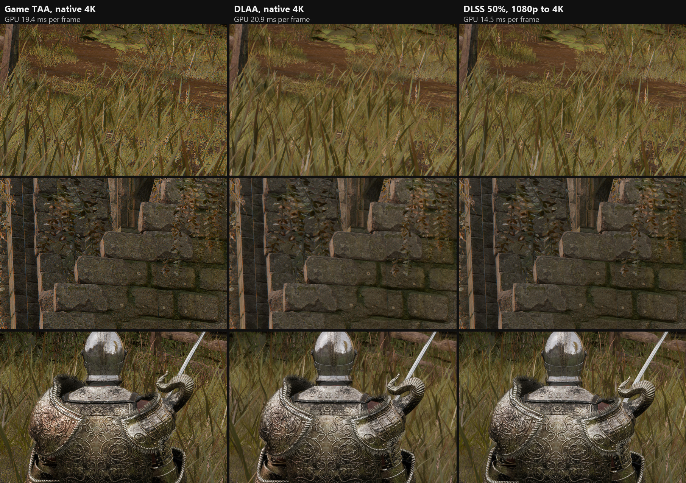

# Elden Ring DLSS

A [ReShade](https://reshade.me) 6.8 add-on that replaces ELDEN RING's temporal anti-aliasing with NVIDIA DLSS on
Direct3D 12: DLAA at native resolution, or upscaling from a lower render resolution through the engine's own
(console) dynamic resolution, plus several fixes the game needs before DLSS looks right. It also makes the game's
ray tracing cheaper, and replaces its ray tracing denoisers with DLSS Ray Reconstruction, fed by the add-on's own
rays.

This is a personal research project, developed and tested on one machine (RTX 5070 Ti, 4K HDR, ELDEN RING App Ver.
1.17.1 (`eldenring.exe` file version 2.7.1.0), ReShade 6.8, [me3](https://github.com/garyttierney/me3) 0.13). It is
published so that the reverse engineering and the lessons in `docs/` do not have to be repeated, and so that others
can play with it: a ready-to-use zip is on the [Releases](https://github.com/masonpetrosky/EldenRingDLSS/releases)
page. Use it at your own risk and offline only (me3 runs the game without Easy Anti-Cheat and keeps it off the
matchmaking servers; do not take it online).



1:1 crops from 4K screenshots of the same view, taken seconds apart (HDR, tonemapped for the web; the grass sways
between shots). The game's TAA sharpens its output, which reads as crisper in a still but is pixel noise that crawls
in motion; DLSS drops that noise, and detail of 4 px and coarser is the same. `GameSharpening=1` puts the game's
sharpening back on top of DLSS if you prefer that look.

Frame rates at the same spot (RTX 5070 Ti, 3840x2160, HDR, Maximum settings with ray tracing on Maximum, frame cap
removed; 5 s each with PresentMon, released add-on):

| | Render size | Average fps | 1% low | GPU time per frame |
| --- | --- | --- | --- | --- |
| Unmodified game (its TAA and ray tracing) | 3840x2160 | 41.7 | 40.0 | 23.9 ms |
| Game TAA + the add-on's cheaper ray tracing | 3840x2160 | 48.4 | 45.5 | 20.6 ms |
| DLAA | 3840x2160 | 45.3 | 43.1 | 22.1 ms |
| DLSS Quality (67%) | 2572x1448 | 62.0 | 58.2 | 16.1 ms |
| DLSS Performance (50%) | 1920x1080 | 69.8 | 64.3 | 14.3 ms |

The ray tracing savings stay on with F9 (game TAA), so the first row was measured with the add-on's refit schedule
switched off (remote `rtdist 0`, `rtrefit 1`); `tools/ab_capture.ps1 -Round showcase` and `showcasert` repeat the
measurements.

## Features

- **DLSS at the TAA**, before tonemapping, with HDR input and the game's exposure (NVIDIA's recommended placement).
  Presets selectable (K, M, L, J, and E, the older CNN model at about half of K's cost). F9 toggles between DLSS and
  the game's TAA.
- **Upscaling** through the engine's dynamic resolution scale (`RenderScale`, e.g. 0.50 = Performance, 0.58 =
  Balanced, 0.67 = Quality). Everything after the TAA was queued by the engine at the render size; the add-on
  corrects those passes per draw (viewports, scissors, resolution constants), stretches the render-size inputs they
  read, and decides at submission time (with GPU predicates) for command lists that land on either side of the TAA.
- **Correct jitter**: a longer jitter cycle while upscaling (the game cycles 8 positions), taken from the TAA
  filter's own counter (the scene constants are sometimes a frame stale, which presets M and L show as judder).
- **Motion vectors for wind-animated vegetation** (grass, bushes, SpeedTree trees), which the game does not write and
  DLSS therefore smears: a port of the game's grass wind shader and a stream-output replay of the tree shaders.
- **Motion vectors for enemies, NPCs and animals**: the game only draws velocity for the player's character. The
  add-on replays the other skinned characters' G-buffer draws with last frame's bones, matched per mesh part.
- **Object-only motion blur** (optional): with the game's Motion Blur on, enemies, animals and swings blur, camera
  turns do not.
- **NVIDIA Reflex** (experimental): the driver's low-latency mode, with the sleep injected at the present.
- **Cheaper ray tracing**: the game re-animates and refits ~200 bottom-level acceleration structures every frame;
  the add-on refits vegetation by distance (near every frame, far every 2nd/4th frame) and characters every frame,
  which halved the ray tracing cost on Maximum in testing.
- **DLSS Ray Reconstruction** (overlay checkbox, `RayReconstruction=1`) while the game's ray tracing is on: it
  replaces the game's denoisers, which blur the sun shadows of grass and leaves and ghost under trees. The add-on
  draws RR's guide buffers (world normals, roughness, diffuse and specular albedo) from the game's G-buffer and
  passes the ray traced signals in raw. See [Ray tracing](#ray-tracing).
- **Its own rays under Ray Reconstruction** (`RtShadowRayGen=3`, the default): a ray generation shader added to the
  game's ray tracing pipeline traces ambient occlusion and the sun shadows with one ray each per pixel at the render
  size, with blue noise. The game traces AO at a quarter of the pixels, and its random numbers form a wave pattern
  that its denoisers hid and RR showed in distant grass.
- Removes the game's chromatic aberration (optional), texture LOD bias for the upscale, fixes for the heat
  distortion, sparks and grace flames at reduced render sizes.

## Ray tracing

ELDEN RING ray traces sun shadows and ambient occlusion (Ray Tracing Quality in the graphics settings). The add-on
changes three things:

- **Cheaper acceleration structures**: the game re-animates and refits about 200 bottom-level structures every
  frame. The add-on refits distant vegetation every 2nd or 4th frame, which took 3.3 ms off a 23.9 ms frame on
  Maximum (the first two rows of the table above).
- **DLSS Ray Reconstruction** replaces the game's shadow and AO denoisers (a temporal filter with about 10 frames of
  history, then two à-trous blurs at half size). It keeps the shadows of grass blades and leaves sharp and ghosts
  less under trees. Tick "Ray Reconstruction" in the overlay; it runs while the game's ray tracing is on.
- **The add-on's own rays** under Ray Reconstruction: one AO ray and one sun shadow ray per pixel at the render size
  with blue noise. On Maximum the game traces 4 AO rays per pixel at half size and 2 shadow rays per pixel; the same
  number of AO rays spread over every pixel gives per-pixel contact shadows, and one shadow ray saved 1.4 ms with no
  visible difference.

Ray Reconstruction itself takes about 4.0 ms at a 50% render scale, 6.3 ms at 67% and 12.4 ms at 100% (DLAA) at 4K
on an RTX 5070 Ti, partly paid back by the denoisers and rays it replaces, so pair it with upscaling.
[`docs/raytracing.md`](docs/raytracing.md) has the details and measurements.

## Requirements

- Windows 10/11, an NVIDIA RTX GPU and a current driver.
- ELDEN RING (Steam), App Ver. 1.17.1 (shown on the title screen). Code patterns and offsets are version specific (see Limitations).
- ReShade 6.8 **with full add-on support**.
- A way to load ReShade into the game without Easy Anti-Cheat. The scripts here use me3 profiles.
- To build: Visual Studio 2022 or later (MSVC, C++20), CMake, Ninja, the Windows SDK (`fxc`, `dxc`), PowerShell 7,
  and the [NVIDIA DLSS SDK](https://github.com/NVIDIA/DLSS) (fetched by a script; not part of this repository).

## Building

```
pwsh tools/fetch_dlss_sdk.ps1     # DLSS SDK headers, static library and DLLs into third_party/dlss (NVIDIA license)
pwsh build.ps1                    # configures and builds build/EldenRingDLSS.addon64
pwsh build.ps1 -Tests             # also builds and runs standalone state/transition regression checks
```

The SDK fetch uses pinned NVIDIA downloads and does not require GitHub CLI or a GitHub login. To run the additional
NGX and NPC window checks on an RTX GPU after building with `-Tests`:

```
build/erdlss_regressions.exe --gpu third_party/dlss/bin/rel
```

These checks run outside the game. They cover state transitions and native feature creation; visual results and
frame-time changes still need in-game testing.

## Installing

Download `EldenRingDLSS-<version>.zip` from [Releases](https://github.com/masonpetrosky/EldenRingDLSS/releases) and
follow its `INSTALL.txt`. In short: take `ReShade64.dll` from the installer of ReShade 6.8 or newer with full add-on
support (the installer opens as a zip archive in 7-Zip), put it into the zip's `EldenRingDLSS` folder as
`ReShade64.asi`, and double-click `EldenRingDLSS.me3` to start the game through me3. F9 toggles DLSS, the ReShade
overlay (Home) has the settings. Nothing is written to the game folder. What changed between versions:
[`CHANGELOG.md`](CHANGELOG.md).

### From a build

`tools/package.ps1` packs the release zip from a build (`dist\`). For development,
`tools/deploy.ps1 -Target main` copies ReShade, the add-on and NVIDIA's release DLSS DLL(s) into an me3 natives folder
and adds it to the `eldenring-default` profile; `-Target dev` makes a separate `eldenring-dlss-dev` profile with
NVIDIA's developer DLLs (watermark, extra logging). Pass `-ReShadeDll <path>` with your ReShade 6.8 add-on DLL.
Without me3, put `ReShade64.dll` (renamed as your loader needs), `EldenRingDLSS.addon64`, `nvngx_dlss.dll` (and
`nvngx_dlssd.dll` for Ray Reconstruction) in the folder your loader uses as ReShade's base path.

The game must be closed while installing (the add-on file is locked while it runs).

## Settings

`EldenRingDLSS.ini` next to the add-on (most are also in the ReShade overlay). The defaults below are the add-on's; the
release zip's ini (`package/EldenRingDLSS.ini`) starts with `Enabled=1`, `WindMotion=1` and `NpcMotion=1` and
documents each key.

| Key | Default | Meaning |
| --- | --- | --- |
| `Enabled` | 0 | DLSS on (1) or the game's TAA (0). F9 toggles it and saves it. |
| `Preset` | 0 | DLSS preset: 0 = NVIDIA's default for the mode, 5 = E, 10 = J, 11 = K, 12 = L, 13 = M. |
| `RenderScale` | 1.0 | Render size per axis; below 1 DLSS upscales (0.50, 0.58, 0.67, 0.77). |
| `GameExposure` | 1 | Give DLSS the game's exposure instead of DLSS's auto-exposure. |
| `GameSharpening` | 0 | Run the game's TAA sharpening on the DLSS output (`SharpenStrength`). |
| `MipBias` | -1.0 | Texture LOD bias for DLAA; log2(RenderScale) is added when upscaling. Needs a restart. |
| `ChromaticAberration` | 1 | Keep the game's chromatic aberration (0 removes it). |
| `WindMotion` | 0 | Motion vectors for wind-animated vegetation. |
| `WindMode` | 1 | 1 = ported grass shader plus tree replay; 0 = stream output for everything. |
| `WindTrees` | 1 | Include SpeedTree trees and shrubs (`WindTreeCapacity`, millions of vertices per frame). |
| `NpcMotion` | 0 | Motion vectors for enemies, NPCs and animals. |
| `ObjectBlur` | 0 | With the game's Motion Blur on, blur only moving objects, not camera turns. |
| `Reflex` | 0 | NVIDIA Reflex low-latency mode (experimental). |
| `RayReconstruction` | 0 | DLSS Ray Reconstruction while the game's ray tracing is on (overlay checkbox). |
| `RtShadowRayGen` | 3 | Under Ray Reconstruction: 3 = the add-on's own AO and sun shadow rays (blue noise), 0 = the game's rays (1, 2 and 4 are development options). |
| `ToggleKey` | 120 | Virtual key code for the DLSS toggle (120 = F9; ignored while Alt, Ctrl or Shift is held). |

`VegetationMask`, `WindPrepass`, `WindCapacity`, `FlipJitterX/Y`, `FlipMotion` and `UseDepthCopy` are development
options.

## How it works

The add-on recognizes the game's passes by the shader debug names FromSoftware ships in the bytecode (`TempAA`,
`GXLightAcc_DDirLightShadowed1`, `GXFfx*`, ...) and works at the D3D12 level through ReShade's add-on API: it
replaces the TAA draw with a DLSS evaluation, edits constant buffers in the upload heap before the GPU reads them,
records extra passes with native D3D12, and watches ray tracing calls (`dispatch_rays`,
`build_acceleration_structure`). Details, measurements and the dead ends:

- [`docs/recon.md`](docs/recon.md): the investigation log: TAA inputs, motion vectors and jitter, the wind motion
  vectors, the engine's dynamic resolution, upscaling and every post-processing fix, with addresses for
  `eldenring.exe` 2.7.1.0.
- [`docs/raytracing.md`](docs/raytracing.md): how the game's ray tracing works (re-animation, refits, DXR
  pipelines, denoisers), its cost, the refit schedule, and Ray Reconstruction (guides, raw signal, findings, next
  steps).
- [`docs/handoff.md`](docs/handoff.md): the current state and working notes for picking the project up.

Source layout: `src/addon.cpp` (events, pass recognition, DLSS at the TAA, post-processing corrections, ray tracing
hooks, remote control), `src/dlss.*` (NGX wrapper, SR and RR), `src/render_scale.*` (the engine's resolution scale),
`src/taa_jitter.*` (jitter cycle and counter), `src/stretch.*`, `src/rr_guides.*`, `src/ao_upscale.*` (native passes),
`src/wind*.*`, `src/tree_*` (vegetation motion vectors), `src/descriptors.*` (descriptor tracking).

## Development tools

- **Remote control** (dev builds): write a command into `remote.txt` next to the add-on, the answer appears in
  `remote.done` (`tools/remote.ps1 "<command>"`). Commands for screenshots (`capture`), motion-vector dumps (`mv`),
  pass logs (`passlog`), the render scale (`scale`), presets, jitter, ray tracing switches (`rtskip`, `rtrefit`,
  `rtdist`, `rtsamples`, `rtinfo`) and Ray Reconstruction (`rr`, `rrraw`, `rrpreset`, `rrdump`); see
  `OnReshadePresent` in `src/addon.cpp`.
- `tools/ab_capture.ps1`: scripted comparison rounds with PresentMon frame-time logs; `tools/frames.py` turns the
  logs into the frame-rate columns above, and `tools/compare_crops.py` makes labeled 1:1 crop sheets like the
  comparison images.
- `tools/mem.py`: read, search and write the running game's memory from outside.
- `tools/rdc_*.py`: RenderDoc 1.46 scripts (run with `qrenderdoc.exe --python`) to list passes, constants, bindings,
  ray tracing calls and readers of a resource in a capture.
- `tools/ghidra/`: headless Ghidra queries (decompile, cross references) against an analyzed `eldenring.exe`.
- `tools/dlss_bench/`: times DLSS SR and RR outside the game.

## Limitations

- Version specific: the TAA filter's vtable address is hard-coded; the resolution scale is found by a code pattern.
  A game update can break either (the add-on then falls back to DLAA or the game's TAA and logs it).
- Tested on one GPU, at 4K and in HDR. Some corrections depend on exact sizes (render sizes are rounded by the engine
  to 4 or 8 pixels).
- Ray Reconstruction at 50-67% shows more shimmer in grass than at DLAA. It comes from the upscale (it stays with the
  game's own rays and with RR off); the add-on's own rays (`RtShadowRayGen=3`, the default) remove the wave pattern
  the game's noise made in distant grass under RR.
- Every normal exit of the game ends in a harmless WER crash report (an allocator check at shutdown); it predates
  this add-on.

## Credits and licenses

The add-on's own code is MIT licensed (`LICENSE`). It uses:

- ReShade's add-on headers and the state/descriptor tracking examples by Patrick Mours (`third_party/reshade`,
  BSD-3-Clause or MIT, see `third_party/reshade/LICENSE.md`).
- Dear ImGui headers (`third_party/imgui`, MIT, see `third_party/imgui/LICENSE.txt`).
- The NVIDIA DLSS SDK, under NVIDIA's license, fetched by `tools/fetch_dlss_sdk.ps1` and not included here.
- NVIDIA NVAPI (MIT), fetched by `tools/fetch_nvapi.ps1` and linked statically for Reflex.

Not affiliated with or endorsed by FromSoftware, Bandai Namco or NVIDIA. ELDEN RING is a trademark of its owners;
DLSS is a trademark of NVIDIA.
